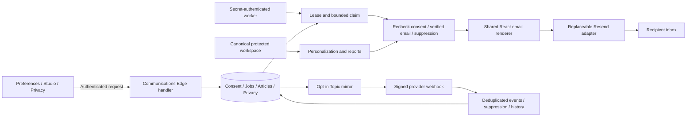
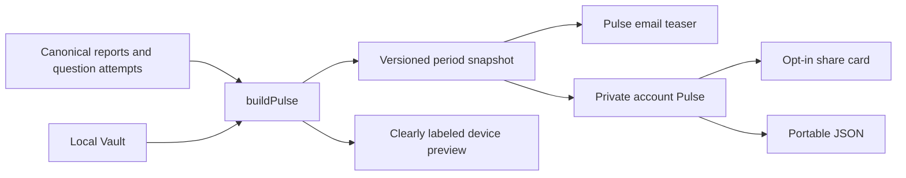

---
tags:
  - axom/feature
  - axom/communications
authority: canonical
---
# AXOM Communications and Pulse

Implemented on `feat/axom-communications-pulse`, based on `c46ae207`, in the isolated
`AXOM-communications-pulse` worktree. This is a local implementation, not a production
release. Resend activation belongs to the operator. No broadcast, push or deployment
was performed. The product name is **AXOM Pulse**, annual label **PULSE // 2026**,
descriptor **Your year in medicine, measured.** The older “Wrapped” source wording
is superseded for this feature only; existing unrelated product features are unchanged.

[Operator runbook](../operations/communications-resend.md) owns external configuration.
[AI handoff](../operations/communications-ai-handoff.md) owns the activation sequence.
Original requests are preserved verbatim in [Ideas 9](../directions/01-ideas/IDEAS-9.md)
and [Ideas 10](../directions/01-ideas/IDEAS-10.md).

## Open and inspect

With Node 22 and the repository's existing dependencies installed:

```sh
node scripts/dev-communications.mjs
```

Open `http://127.0.0.1:5196/#communications`. Signed-out users can inspect local email
previews and Pulse. Saving account settings requires a configured Supabase account
and the deployed communications function. The development server has an isolated
Vite cache so concurrent AXOM worktrees do not corrupt dependency resolution.

Generate the complete local visual handoff:

```sh
node scripts/build-communications.mjs
node scripts/render-communications-auth.mjs
node scripts/preview-communications.mjs
node scripts/verify-communications-artifacts.mjs
node scripts/verify-communications-previews.mjs
node scripts/verify-communications-gallery.mjs
```

Open `artifacts/communications/index.html`. It contains 20 real-renderer templates,
four visual treatments, two appearances, four accents, desktop/mobile controls and
plain-text alternatives. The gallery also includes a capture of the real Pulse sheen.
The browser test generates real app screenshots and share-card PNGs in that folder.
To refresh the optional motion capture, install Playwright’s video runtime with
`web/node_modules/.bin/playwright install ffmpeg`, ensure `ffmpeg` is on PATH, then run
`node scripts/capture-communications-motion.mjs` with the communications dev server up.
The recorder uses a fresh synthetic profile and two encoding threads.

Its fictional Alex Morgan fixtures are explicitly illustrative; no fixture is imported
into production source. Screenshots and preview files are ignored artifacts. Their
generators and verification journeys are committed. The gallery includes local copies
of its five linked documents, so it works both from disk and when served as the HTTP
root. `preview-manifest.json` binds these outputs to their current renderer, generator,
Orb and canonical documentation; the integrity check rejects stale or edited outputs.

After committing the verified source, run `node scripts/package-communications-handoff.mjs`.
It requires a clean worktree and browser reports matching the current preview manifest.
The commit-named ZIP contains only the gallery's declared files, linked screenshots and
motion capture, checksums, browser evidence and the feature patch from `c46ae207`.
It is a review/AI handoff, not an application checkout. Continue the existing branch;
do not reapply the patch there. Older delivered ZIPs are preserved.

## Visual walkthrough

1. **Communications:** an Orb-led optical-glass header inside AXOM's existing shell. Study,
   Editorial and AXOM groups have illuminated inset panels and ten independent switches.
   Enabled schedules expose local time, weekday where relevant, and one timezone.
   A live adjacent email preview makes the choices tangible. Save/error/unsaved states,
   an all-optional unsubscribe action and recent delivery history complete the flow.
2. **Email:** four treatments share the same safe renderer: **Orb / Pulse** has an
   oversized annual Orb; **Glass / Reports** has inset metric panels; **Letter / Editorial**
   uses literary Georgia headlines; **Frost / Account** keeps essential messages compact.
   All use the canonical Orb, rounded double borders, personal accent and a restrained
   highlight. Tables, inline solid backgrounds and live text form a complete static
   layout. Arial/Courier/Georgia avoid remote font dependence. The masthead sheen is
   progressive enhancement, enabled only under `prefers-reduced-motion: no-preference`.
   One 2.4-second sweep starts after 0.6 seconds, then remains static. Inboxes lack the
   app's pause control, so they do not loop the decoration. The raw style block contains
   only static, authored CSS; preserving its quotes is necessary for pseudo-elements
   to render correctly in React server output. User content is still escaped.
3. **Pulse:** a glass headline panel faces the authentic Orb inside an optical lens and
   fine orbital rings. A reflection crosses the panel and lens for roughly 2.4 seconds
   per 12-second cycle, with staggered metric-panel reflections. Only transforms and
   opacity animate. A visible Pause/Resume motion control complements OS and AXOM
   reduced motion; visibility observers pause decoration offscreen and in hidden tabs.
   Scrolling reveals recorded effort, accuracy trajectory, system strengths/improvement,
   courses, recall/play and milestones. Reduced motion reveals everything immediately.
4. **Share card:** actual 1080 × 1350 PNG rendering, layered graphite glass, a fixed
   reflection, canonical Orb, four available statistics and period/denominator context.
   Name inclusion starts off. Download, clipboard and platform sharing are user-triggered.
   JSON retains the underlying record. Nothing publishes automatically.
5. **Studio:** an administrator-only composer with subject/preheader variables,
   full canonical essay text, excerpt, reading time, optional illustration, CTA and
   bounded audience selection. Desktop/mobile and light/dark previews are alongside.
   Draft → audience review → allowlisted test → typed scheduling confirmation.
   A separate section publishes the article and exports Resend Broadcast files.
6. **Privacy & Data:** quiet, numbered glass sections for local backup, private account export,
   communications and account removal. Deletion offers a backup first, requires a
   recent sign-in and typed confirmation, shows its deadline and supports cancellation.

Desktop and 390px layouts are designed separately. Controls use native input semantics,
visible keyboard focus, status announcements and touch-sized action areas. No generated
image was needed: the authentic Orb and actual interface carry the design.

### Optical glass implementation

The reference was JD's actual **Anki Future Glass / Basic CSS**: translucent gradient
layers, an illuminated rim, and the ten-second `lusterSweep`. This is an adaptation to
AXOM's palette and reading density; the Anki source/decks were not edited or copied into
this public repository. Light mode uses porcelain glass and darker accent text.

`CommunicationsBrand` standardizes the existing Orb. Scoped optical tokens live in
`communications.css`; `useOpticalMotion` manages observer/visibility lifetime. No new
application dependency, persistence contract, provider logic or migration was added.
A named `axom-auth-code` slot replaces the old spacer-dependent OTP insertion; generation
asserts every code and the correct presence/absence of secure links before writing.

Email animation and blur support vary by client. The design does not require either:
[animation support tests](https://www.caniemail.com/features/css-animation/) and
[backdrop-filter support tests](https://www.caniemail.com/features/css-backdrop-filter/)
justify the static-first delivery boundary. Browser previews are not proof of Gmail,
Apple Mail or Outlook rendering. No tracking pixel or script is introduced.
The finite inbox sweep follows [W3C pause/stop guidance](https://www.w3.org/WAI/WCAG22/Understanding/pause-stop-hide.html).
The browser verifier checks actual pseudo-element animation, its visible and settled
states, all 320 reduced-motion viewports and 16 stylesheet-stripped fallbacks. The
separate gallery verifier exercises its controls, video and local document link closure
through HTTP at desktop/mobile sizes. These remain local-browser checks, not inbox proof.

## Discovery and reuse

| Existing authority | Reuse in this feature |
| --- | --- |
| `web/`, React 18, Vite 8, TypeScript, Zustand | Existing stack and UI primitives; no dependency or lockfile change |
| `account/accountStore.ts`, `account_profiles`, Supabase Auth | Existing sessions/verified identity; SMTP keeps the existing auth flow |
| `workspaces` + `workspace_revisions` | Latest protected copy feeds scheduled reports; local Vault remains primary |
| `reports.ts` | Canonical corrected study minutes, active dates, consistency and current eligible streak |
| `learning-intelligence/attempts.ts`, `patterns.ts` | Answer events, denominators, first-exposure scope and minimum group evidence |
| `examPlan.ts`, `boardPrep` | Existing selected upcoming board-prep exam, date, name and destination; no task-title guesses |
| `palette.ts`, `theme.ts`, `public/icons/axom-orb-512.png` | Existing accent/appearance and current Orb |
| `backup.ts` | Existing portable local backup, including supported attachments |
| `dailyWordPuzzles`, Daily Games flags/navigation | Only current, enabled games appear; no external results are fabricated |
| Existing `#reports`, course and exam routes | Email actions land in working product surfaces |

No previous Resend adapter, email queue or canonical article store existed in this
checkout. The additive communications tables fill those gaps. Local schema remains 34;
Noctyrium storage identifiers are preserved. The original dirty course/QBank worktree
and its private data were not staged or edited.

## Architecture





The Edge deployment bundle is generated from the same TypeScript sources used by the
web app. `service.js` is a committed build artifact, not a separately maintained report
engine. Regenerate it after changing communication or imported canonical report code.

## Preferences and sending rules

All ten optional categories default off: daily learning, daily games, weekly report,
monthly report, exam reminders, annual Pulse, essays, product updates, research/news,
and offers/announcements. Inactivity is part of the explicitly enabled daily-learning
category. Authentication, security, account, export and deletion messages are essential.
Optional unsubscribe does not disable those essential categories; invalid addresses,
unverified addresses and provider suppression still prevent unsafe delivery.

Timezones are validated IANA identifiers. Weekly reports use the chosen weekday and
local time. Monthly reports use that weekday in the first seven days of the month and
summarize the completed prior month. Annual Pulse runs January 1 for the previous year.
Missed local times catch up during the same day; a repeated DST hour has the same unique
period key. Worker downtime across an entire due day is visible operational downtime,
not an invented backfill. Exam reminders use 14/7/3/1 days before the existing exam date.
After 14 days without recorded study or answer activity, daily learning becomes at most
one calm return email per calendar month. Games respect feature/navigation preferences.

The scheduler scans at most 200 enabled preference rows per pass with a persisted cursor.
Campaign expansion scans at most 200 candidates for each of two campaigns per pass.
Audience counts explicitly identify a first-batch estimate when more candidates remain.
Recipient eligibility is checked again immediately before each send. A cancelled
campaign suppresses remaining work; a message already accepted by Resend cannot be recalled.

Unique job keys protect welcome, period reports and campaign-recipient pairs. A global
worker lease and `SKIP LOCKED` claim prevent concurrent workers from sending the same job.
The exact provider request is frozen before the first network attempt. Changes to a
profile, sender or signed-link generation cannot change the body on retry. A changed
recipient address suppresses the saved request. Up to five attempts use increasing delays.
Retries outside the conservative 23-hour provider-idempotency window, measured from the
first attempt rather than queue creation, stop for reconciliation. Interrupted fifth
attempts are also surfaced instead of remaining locked forever. An unverified signup's welcome is
deferred hourly for up to 30 days, without consuming delivery attempts.

Webhook signatures verify the exact raw body and a five-minute timestamp tolerance.
Duplicate events do not double-process; interrupted processing can retry. A webhook
that arrives before the send acknowledgement waits for reconciliation. Unmatched
SMTP/Broadcast events are acknowledged after a 15-minute grace window so they cannot
starve local pending events. Late sent/delivered
notifications cannot undo a complaint. Bounce, complaint and provider suppression
conservatively block the address. Provider opt-outs update canonical AXOM consent;
provider opt-ins never manufacture consent. Newer AXOM choices are not overwritten by
older provider events. Opens/clicks are not used for product state or readiness.

## Template catalog and dependencies

| Template | Trigger / required source | Main action |
| --- | --- | --- |
| Welcome | New account profile; verified address before send | Enter AXOM |
| Authentication | Supabase confirmation, OTP/link, recovery, invitation, email change, reauthentication | Secure Supabase-generated action |
| Security | Supabase security notification template | Review account |
| Daily learning | Opt-in and a recorded course/activity context | Continue course |
| Daily Games | Opt-in and at least one enabled current game | Open available games |
| Weekly report | Opt-in; completed-week snapshot | Existing Reports page |
| Monthly report | Opt-in; completed-month snapshot | Existing Reports page |
| Exam reminder | Opt-in; dated canonical exam plan | Correct existing exam lane |
| Inactivity | Daily-learning consent; inactivity threshold | Return to course |
| Essays & Notes from Jafar | Opt-in; canonical article or approved HTTPS destination | Read essay |
| Product update | Opt-in; administrator-authored content | Configured safe destination |
| Research & News | Opt-in; administrator-authored content | Configured safe destination |
| Marketing | Separate opt-in; administrator-authored content | Configured safe destination |
| AXOM Pulse | Separate opt-in; annual snapshot | `/pulse/:year` |
| Export requested | Verified user's request | Privacy & Data |
| Export ready | Completed private export; authenticated Privacy & Data link | Fresh secure download |
| Deletion requested | Recent-login request | Privacy & Data |
| Deletion scheduled | Persisted deletion deadline | Cancel/manage request |
| Deletion cancelled | Successful owner cancellation | Privacy & Data |
| Deletion completed | Confirmed account removal | Informational receipt |

`TEMPLATE_DEPENDENCIES` gates dispatch. Missing statistics are omitted, not converted to
zero. Template interpolation permits only firstName, displayName, currentCourse,
examName and daysUntilExam. Author text is escaped by React; arbitrary HTML is not accepted.
Invalid variables are explained in the preview and rejected before saving.

The six generated Supabase auth files preserve `{{ .Token }}` and valid
`{{ .ConfirmationURL }}` placeholders. Reauthentication is OTP-only. The generic security
file is an operator-installed skin for Supabase's supported security notification types.
Auth/security transmission remains inside the existing Supabase Auth infrastructure.

## Pulse metric contracts and limits

A snapshot is keyed by account, scope and period, retains source revision hash/timestamp,
and is immutable. The annual email and account page load that exact record. A current-year
preview ends on the current local day; each new end date can create a new snapshot.
Device previews clearly identify their source. Account copies can lag device activity.

- Questions answered count actual answer events, excluding flag-only events.
- Overall accuracy includes repeats and Tutor answers and exposes its denominator.
- First-answer accuracy excludes Tutor; system comparisons require eight first answers.
- Improvement needs eight scored first answers in each half of the period.
- Comparison deltas need eight scored attempts in both equal-length periods.
- Study minutes and active study dates reuse the canonical corrected report calculation.
- Anki Lab review count is supported. External Anki retention and matured-card counts are unknown.
- Course journey lists courses with recorded answers; it does not infer course completion.
- DailyWord completed-day count is supported. DoctorDle is an external game link.
  Pathordle/Radiordle are not wired in this checkout and therefore are not invented.
- No readiness guarantee, ranking, percentile or diagnostic claim is generated.

The current profile avatar is a device-owned data URL, not a production-hosted public
image. It is intentionally omitted from outgoing email; the authentic Orb is the fallback.
Longest study session/annual longest streak and external game wins are not inferred from
ambiguous aggregate logs. Missing fields stay absent. No optional audio is shipped.

## Editorial delivery paths

**AXOM-managed:** canonical article + draft, bounded audience (`subscribers`, selected
account IDs or existing course ID), review/test, typed scheduling confirmation. Scheduling
and article publication share one database transaction. Audience generation is asynchronous.

**Resend Broadcast:** publish the canonical essay with its own explicit confirmation,
then export HTML and JSON/text/subject. The export contains Resend's native unsubscribe
variable. Choose the corresponding opt-in Topic in Resend and send there. This generic
export deliberately omits private per-recipient course/exam information. Do not also
schedule the same draft through AXOM. Broadcast delivery history lives in Resend; it does
not appear as individually queued AXOM jobs. Canonical article content remains in AXOM.

No cohort filter was invented because no authoritative cohort membership service exists
in this checkout. Selected IDs and course membership provide bounded existing-data filters.

## Privacy state and retention

Exports: requested → processing → ready or failed. The private JSON contains account-held
profile metadata, latest protected workspace, consent/presentation, Pulse records,
communications history and request history. Device-only source/attachment binaries are
outside that account export; the existing local backup preserves supported local media.
Privacy reads the portable backup's actual result. If attachment bytes are unavailable,
it reports the number of missing images next to the download action and carries that
warning into both deletion confirmation steps. The metadata-only copy is still saved;
it is never presented as complete. A successful retry clears the warning and reports
the included image count. Local backup feedback does not depend on an account refresh.
A restrictive Storage policy protects the export bucket even if another bucket has a
broad permissive policy. An existing public export bucket makes migration fail closed.
Objects are capped at 25 MB, retained seven days and accessed using 15-minute signed links.
The email opens authenticated Privacy & Data, where the download link is minted on demand;
a delayed or retried email never freezes an expired storage URL.
Expired objects and capabilities are pruned. Stale export processing can retry the same
object idempotently.

Deletion: scheduled → processing → completed or failed; scheduled/failed requests can
be cancelled while an account remains. A seven-day grace period is an explicit product
assumption, behind `AXOM_ACCOUNT_DELETION_ENABLED=false` by default. Processing removes
export objects, the Resend contact, linked raw delivery events and the Auth account;
foreign-key cascades remove eligible app records. A minimal receipt survives long enough
to send completion and then clears its email address. Interrupted destructive processing
is marked `deletion-reconciliation-required`, not blindly rerun. Device-local data and
provider/database backups are not claimed to be remotely erased. The operator must verify
retention against the actual deployed project before enabling removal.

Post-deletion receipts freeze their provider body and have their own bounded retry
clock. A failed receipt does not rerun deletion or block other privacy work. Successful
or suppressed receipts clear their saved recipient and message; exhausted receipts
require operator reconciliation.

Processed raw webhook payloads are pruned after 30 days. Address suppression is retained
to avoid re-enrolling complained/bounced recipients. Resend delivery records and backup
retention remain provider/operator-controlled. No secret is included in user-facing errors.

## Files and routes

New implementation: `web/src/lib/communications/{model,context,snapshot,email,presentation,client}`;
server modules `{provider,service,privacy,campaigns,handler}`; five pages; scoped
`communications.css`; unit/database/server/browser tests; build/auth/preview/dev scripts;
Edge function, generated bundle and auth templates; additive migration
`20261010000100_communications_pulse.sql`.

Existing source edits are limited to `App.tsx` routes/titles, account-tab Settings links,
`supabase/config.toml` function auth mode and the Vercel Pulse redirect. No store, backup,
package or lockfile changes. Shared App/Settings edits need integration with active work.

| Route | Access |
| --- | --- |
| `/#communications` | Local previews; authenticated account preferences/history |
| `/#privacy` | Local backup; authenticated export/deletion |
| `/#communications-admin` | Server-authorized administrator |
| `/#pulse?year=2026` | Private local/account record |
| `/pulse/2026` | Vercel redirect to hash route; preserves current relative asset base |
| `/#essay?id=<uuid>` | Public only after canonical article publication |
| `/functions/v1/communications?action=...` | Authenticated API, separately secured worker/webhook/unsubscribe |

## Verification and rollout boundary

The local verification ledger is in the [AI handoff](../operations/communications-ai-handoff.md).
Pure rendering, signature verification, consent/suppression, timezone/DST logic, canonical
metrics, SQL/RLS, queue uniqueness, privacy expiration and campaign publication have
focused automated coverage. Chrome tests exercise real React UI with a synthetic account
API boundary and recorded fixtures. Those mocks do not establish a deployed Resend/Supabase
integration. Gmail, Apple Mail and Outlook rendering, real SMTP, deliverability/DNS,
cron execution and deletion of a disposable live account remain operator acceptance work.

A production rollout requires the exact [runbook](../operations/communications-resend.md),
then test-recipient verification, then deliberate live activation. No new external paid
service was used during implementation.
